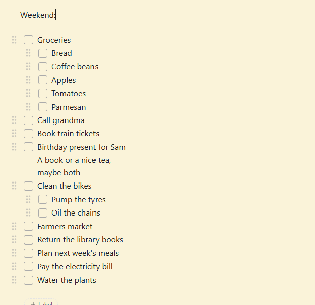

# Full Keep Mode for Obsidian

An [Obsidian](https://obsidian.md) plugin that brings the Google Keep
experience to Obsidian: a board of coloured cards, pinned and archived notes,
reminders, quick notes, and checklists that tidy themselves up the way Keep's do.



## Features

### Notes and the board

- **Pin and colour buttons** in every note's top bar, in tabs and in the
  board's pop-up. Pinned notes come first on the board.
- **Keep's bars on phones.** In the pop-up, the top bar has just back, pin,
  reminder and archive; a bottom bar has "+" (checkboxes, image, recording),
  colour, undo/redo and "⋮" (delete, make a copy, labels). Both stay put while
  the note scrolls.
- **An open note has its colour**, the same shade as its card, like in Keep.
- **Keep titles.** Imported notes show their Keep title even where a file name
  can't hold it ("Sept/Oct 2026" is saved as "SeptOct 2026"). Editing the title
  renames the note too.
- **Notes look like Keep's.** No properties above the text; the note's tags
  are shown as labels below it, with "Edited …" (hover for when it was
  created). They're outside the text, so they can't be edited by accident and
  Ctrl/Cmd+A selects only the text.
- **Archive** a note from its top bar, with "Undo" in the confirmation, like in
  Keep. Archived notes leave the board and show up in its Archive view. Notes
  tagged `#archived` (as imported from Keep) count as archived too.
- **Reminders.** The bell in a note's top bar offers Keep's choices (later
  today, tomorrow, next week) or any date and time. When a reminder is due, a
  notice pops up in Obsidian, plus a system notification on desktop. Reminders
  that fell due while Obsidian was closed are shown when you open it.
- **Search bar** always at the top of the board, like Keep's. It finds notes by
  title, label and text.
- **Labels side menu**, like Keep's: Notes, Reminders, your labels and Archive
  in the left sidebar (the drawer on phones), opened with the ☰ button in the
  search bar. Click one to show it on the board.
- **Labels on a note**: the pencil/"+ Label" button below the note (or "Labels"
  in the note's ⋮ menu) opens Keep's "Label note": tick labels or type a new one.
- **"Take a note…"** at the top of the board opens a new note in a pop-up, title
  ready to type. The checkbox icon at its right end starts a **new list**
  instead. A note taken while the board shows a label gets that label. Close it without writing anything and it's thrown away, like in
  Keep.
- **Drag cards** to reorder the board: with the mouse, or hold a card and drag
  it on a phone or tablet. A dragged card takes the place of the card you drop
  it on.
- **"Create a Keep board"** sets up a ready-made board: newest notes first,
  pinned ones on top, archived notes in a separate Archive view.

The board itself is drawn by the
[Keep Bases View](https://github.com/k4fn/keep-bases-view) plugin;
Full Keep Mode adds the rest. Both use the same note properties, `keep_pinned`
and `keep_color`. A note's place on the board is stored in `keep_order`, its
archived state in `keep_archived` and its reminder in `keep_reminder`.

### Checklists

- **Ticked items move down** below a "*N* ticked items" divider. Untick one and
  it moves back up.
- **Ghost parents.** Tick a sub-item of an item that isn't done yet, and it
  shows in the ticked section under a faded copy of its parent, like in Keep.
  The note itself keeps it under its parent.
- **Ticking an item ticks its sub-items** along with it.
- **Drag and drop.** Every item has a grip next to its checkbox. Drag it up or
  down to move the item, sideways to indent or outdent it, with a mouse or a
  finger. An item takes its sub-items along.
- **Two levels, like Keep.** An item can be indented once. You can allow three
  levels or unlimited in the settings.
- **Multi-line items line up.** Extra lines of an item (Shift+Enter) and
  wrapped lines start exactly under the item's text.
- **Checkboxes stay checkboxes.** The cursor never lands inside `- [ ]`, and
  a selection doesn't turn checkboxes back into brackets. Backspace at the
  start of an item joins it to the item above, Delete at the end of an item
  joins the next one, like in Keep.
- **Show / hide checkboxes** (in the note's ⋮ menu), like Keep: turns the
  note's lines into a checklist and back.
- **Undo and redo buttons** in the note's top bar. Ticking an item and its move
  to the bottom are one step, so one undo restores the list.

Everything is **plain Markdown**: properties in the note's front matter and
ordinary `- [ ]` / `- [x]` lists. Nothing is stored anywhere else.

## How the checklist rules work

| You do | Result |
|---|---|
| Tick an item | It moves below the divider, with its sub-items |
| Tick a sub-item | It shows under a ghost of its parent in the ticked section |
| Drag an item onto another place | It moves there with its sub-items. Dropped at the top level below an item that has sub-items, it lands after them. |
| Drag a sub-item out to the top level, in place | The sub-items below it become its own |
| Drag an item to the right, or press Tab | It's indented under the item above, sub-items included (still two levels) |
| Tab on an indented item, or on the first item | Nothing; there are only two levels |

## Getting started

1. Install **Full Keep Mode** and **Keep Bases View** (Settings → Community
   plugins → Browse) and enable both.
2. Run the command **Create a Keep board** (Ctrl/Cmd+P).
3. Optional, to match Keep: turn off **Settings → Editor → Fold indent**, so
   list items can't be collapsed.

The checklist features work in any note, with or without the board.

## Settings

| Setting | Default |
|---|---|
| Hide properties | on |
| Keep titles | on |
| Labels and edit date below the note | on |
| Pin button | on |
| Colour button | on |
| Archive button | on |
| Reminders | on |
| "Take a note…" bar | on |
| Search bar | on |
| Labels side menu | on |
| Drag cards | on |
| Move ticked items down | on |
| Ticked sub-items under a ghost parent | on |
| Tick sub-items along | on |
| Drag handles (checklists) | on |
| Indent levels | Two levels, like Google Keep |
| Line up multi-line items | on |
| Undo and redo buttons | on |

To keep the checklist features out of a single note, give it the property
`full-keep-mode: false`.

Commands: **Take a note**, **Take a note as a checklist**, **Labels of this
note**, **Show or hide checkboxes in this note**, **Open the labels side menu**,
**Create a Keep board**, and **Move ticked items down in this note** (tidies up
a list that already has ticked items in between).

## Installation

From Obsidian: **Settings → Community plugins → Browse**, search for
"Full Keep Mode", install and enable.

Manually: download `main.js`, `manifest.json` and `styles.css` from the
[latest release](../../releases/latest) into
`<your vault>/.obsidian/plugins/full-keep-mode/`, then enable the plugin under
**Settings → Community plugins**.

## Limitations

- Checklists work in the editor (Live Preview and Source mode), not in Reading
  view.
- On phones, Obsidian's own indent button in the toolbar isn't limited to two
  levels; Tab and dragging are.
- Reminders pop up only while Obsidian is running (missed ones are shown when
  it opens). Obsidian can't wake a phone the way Keep's reminders do.
- Labels are tags in the note's properties; Obsidian tags can't contain spaces,
  so a new label "Book club" becomes "Book-club".

## Development

There's no build step: `main.js` is the plugin as it ships.

The tests in `tests/live_test.py` run against a real Obsidian. They create
temporary notes and a temporary board, tick, drag with real mouse events, press
Tab, pin, colour, archive, set reminders and take notes, and check the results:

```bash
# Start Obsidian with its debugging port (close it first). Windows:
"%LOCALAPPDATA%\Programs\Obsidian\Obsidian.exe" --remote-debugging-port=9222
# macOS:
open -a Obsidian --args --remote-debugging-port=9222

pip install websocket-client pillow
python tests/live_test.py      # the tests (keep the Obsidian window visible)
python tests/record_demo.py    # re-records docs/demo.gif
```

## License

[MIT](LICENSE)
