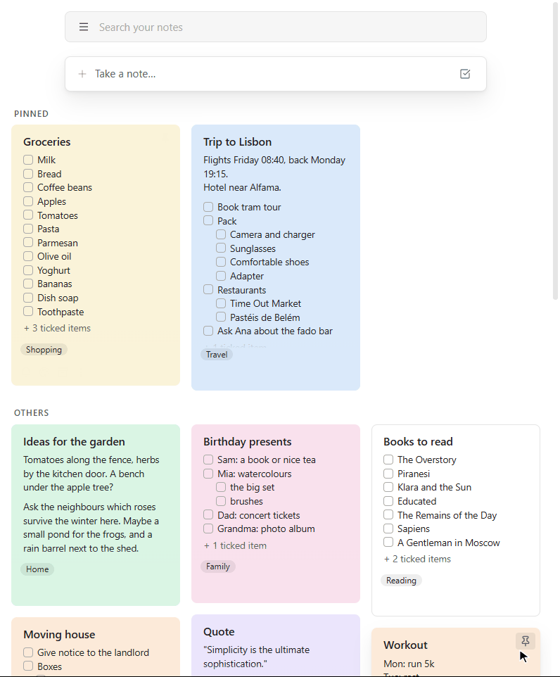
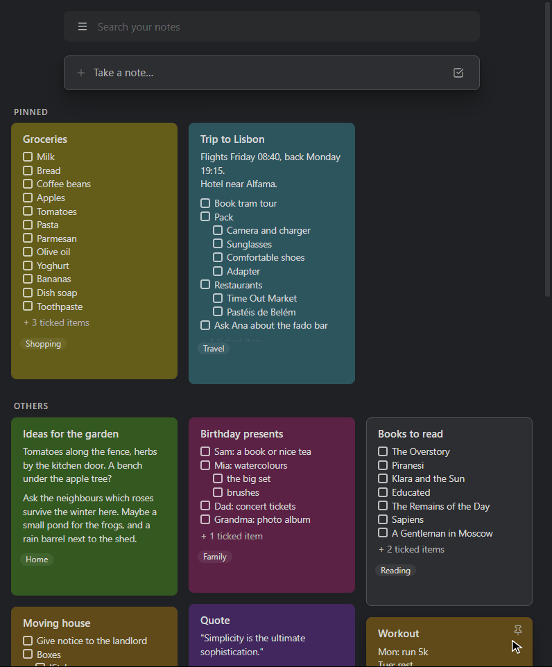

# Full Keep Mode for Obsidian

**It's just like Google Keep, but in [Obsidian](https://obsidian.md), with
your notes as plain Markdown files that you own.**

The board of coloured cards, pins, labels, the archive, reminders,
"Take a note…", and Keep's checklists, where ticked items drop to the bottom and
sub-items follow their parent. If you know Keep, you already know how to use it.

**New to Obsidian and only ever used Keep?** This plugin is made for you. Install
it, import your Keep notes, and you're on a board that looks and works like the
one you're used to. Nothing to learn first; the rest of Obsidian is there
whenever you want it.



<details>
<summary><b>In dark mode</b></summary>



</details>

## Why Full Keep Mode

- **Just like Google Keep**, on your computer and in Obsidian's phone app: same
  board, colours, pins, labels, side menu and checklists; notes open full screen
  on a phone with Keep's top and bottom bars.
- **Faster than Keep.** Everything is on your device, so the board opens and
  searches instantly. In daily use it feels quicker than Keep itself.
- **Your notes stay yours.** Every note is an ordinary Markdown file, synced
  however you like; with [Obsidian Sync](https://obsidian.md/sync) your board
  is the same on your phone and computer.
- **Works offline. One plugin, nothing else to install.**

## Keep, feature by feature

| In Google Keep | In Full Keep Mode |
|---|---|
| Board of cards, "Pinned" and "Others" | ✓ two columns on phones, pinned first |
| Note colours | ✓ Keep's colours, light and dark |
| Pin, archive (with Undo), reminders | ✓ on the card and in the note |
| Labels, side menu (☰), "Edit labels" | ✓ |
| Search bar, "Take a note…", "New list" | ✓ |
| Drag cards to reorder, tick items on a card | ✓ |
| Checklists: ticked items move down, sub-items, two levels | ✓ Keep's exact rules |
| Drag items, swipe sideways to indent (phone) | ✓ |
| Note opens over the board (full screen on phones) | ✓ |
| Your notes from Keep | ✓ imported with their order, colours, labels and sub-items |

## Checklists, just like Keep's


<details>
<summary><b>Everything checklists do</b></summary>

- **Ticked items move down** below a "*N* ticked items" divider, with their
  sub-items. Untick one and it moves back up.
- **Ghost parents.** A ticked sub-item of an unfinished item shows in the
  ticked section under a faded copy of its parent, like in Keep.
- **Drag and drop.** Drag an item's grip up or down to move it (with its
  sub-items), sideways to indent or outdent it. On a phone you can also swipe
  an item sideways, anywhere on it.
- **Two levels, like Keep** (three or unlimited in the settings). Tab indents;
  Enter at the end of an item with sub-items starts a new sub-item.
- **Multi-line items** (Shift+Enter), wrapped lines and pasted lines line up
  under the item's text.
- **Checkboxes stay checkboxes.** The cursor never lands inside `- [ ]`;
  Backspace and Delete join items like in Keep.
- **Undo and redo buttons.** A tick and its move are one step.

| You do | Result |
|---|---|
| Drag an item elsewhere | It moves with its sub-items; dropped below an item with sub-items, it lands after them |
| Drag a sub-item out to the top level, in place | The sub-items below it become its own |
| Drag right, swipe right or press Tab | Indented under the item above, sub-items included |

</details>

<details>
<summary><b>The board and notes in detail</b></summary>

- **Cards** show the colour, title, text or unticked items ("+ 3 ticked
  items"), first image, reminder and labels. Hover a card for Keep's buttons;
  right-click it (or hold it on a phone) for its menu.
- **Click a card** to open the note over the board. On a computer it covers
  just the board's tab, so you can switch tabs and come back to it.
- **The board is your home screen**: it opens when Obsidian starts.
- **"Take a note…"** opens a new note with the title ready to type; closed
  untouched, it's thrown away.
- **Notes** have pin, colour, reminder and archive buttons in the top bar,
  hidden properties, and their labels and "Edited …" below the text.
- **Keep titles** can have characters a file name can't ("Sept/Oct 2026").
- **Reminders** pop up in Obsidian (plus a system notification on a computer).

</details>

## Moving from Google Keep

Run **Import from Google Keep** (or use the button in the plugin's settings) and
choose an export of your notes. There are two ways to get one:

- **Google Takeout (easy).** At [takeout.google.com](https://takeout.google.com)
  select only Keep, download and unzip it, and choose its `Keep` folder. You get
  your notes, ticks, colours, pins, archive, labels and images, but **not** the
  order of your notes (newest come first) and **not** checklist sub-items (they
  come in flat).
- **The export script (everything).** Also keeps the order of your notes and the
  sub-items. It needs Python and a one-time sign-in code; see below.

<details>
<summary><b>How to use the export script</b></summary>

1. Install [Python](https://www.python.org/downloads/), then:
   `pip install gkeepapi gpsoauth requests`
2. Download [`tools/keep_export.py`](tools/keep_export.py).
3. Get a one-time sign-in code: open
   <https://accounts.google.com/EmbeddedSetup>, sign in and click "I agree"
   (the page may keep loading; that's fine). Then open the browser's developer
   tools → Application (Chrome) or Storage (Firefox) → Cookies →
   accounts.google.com, and copy the value of `oauth_token`.
4. Run `python keep_export.py you@gmail.com` and paste the code when asked.
   It's typed invisibly, used once to sign in, and never saved.
5. In Obsidian, run **Import from Google Keep** and choose the `keep-export`
   folder the script made.

The script only reads from Keep. Google has no official way for apps to read
Keep, so it uses [gkeepapi](https://github.com/kiwiz/gkeepapi), the unofficial
library other Keep tools use too.

</details>

Either way, notes in Keep's trash are left out, and reminders aren't in Google's
exports. Import on a computer; the notes then reach your phone like any others.

## Getting started

1. Install **Full Keep Mode** (Settings → Community plugins → Browse) and
   enable it. It needs Obsidian 1.10 or later; nothing else.
2. Run **Create a Keep board** (Ctrl/Cmd+P), or use the button in the settings.
3. Optional: import your notes from Keep (above).

To install by hand, put `main.js`, `manifest.json` and `styles.css` from the
[latest release](../../releases/latest) into
`<your vault>/.obsidian/plugins/full-keep-mode/`.

**Privacy:** everything stays in your vault. The plugin makes no network
connections; it reads your notes only to show them on the board and to search and
list your labels.

**Good to know:** reminders show up while Obsidian is open, and missed ones
appear when you open it. Obsidian doesn't let plugins schedule notifications,
so a reminder can't reach your phone while Obsidian is closed.

<details>
<summary><b>Settings, commands and how notes are stored</b></summary>

Every feature can be turned off in the plugin's settings (all on by default;
checklists have two levels, like Keep). To keep the checklist features out of
one note, give it the property `full-keep-mode: false`.

Commands: **Take a note**, **Take a note as a checklist**, **Labels of this
note**, **Show or hide checkboxes in this note**, **Open the labels side menu**,
**Create a Keep board**, **Import from Google Keep**, and **Move ticked items
down in this note**.

Everything is **plain Markdown**: ordinary `- [ ]` / `- [x]` lists, and
properties in each note: `keep_pinned`, `keep_color`, `keep_order` (the place
on the board), `keep_archived`, `keep_reminder`, `keep_title` and `tags` (the
labels). The board is an Obsidian Bases file (`.base`) with views of type
`keep-board`.

</details>

<details>
<summary><b>Development</b></summary>

There's no build step: `main.js` is the plugin as it ships. The tests in
`tests/live_test.py` run against a real Obsidian, with real mouse and key
events:

```bash
# Start Obsidian with its debugging port (close it first). Windows:
"%LOCALAPPDATA%\Programs\Obsidian\Obsidian.exe" --remote-debugging-port=9222
# macOS:
open -a Obsidian --args --remote-debugging-port=9222

pip install websocket-client pillow
python tests/live_test.py                 # the tests (keep the Obsidian window visible)
python tests/phone_test.py                # the same Obsidian in its phone layout
python tests/record_board_demo.py         # re-records docs/board.gif (--dark: board-dark.gif)
python tests/record_demo.py               # re-records docs/demo.gif
```

</details>

## Support

If Full Keep Mode made your move from Keep easier, you can
[buy me a coffee on Ko-fi](https://ko-fi.com/gabrielleuenberger) or star this
repo. Thank you!

## License

[MIT](LICENSE)
